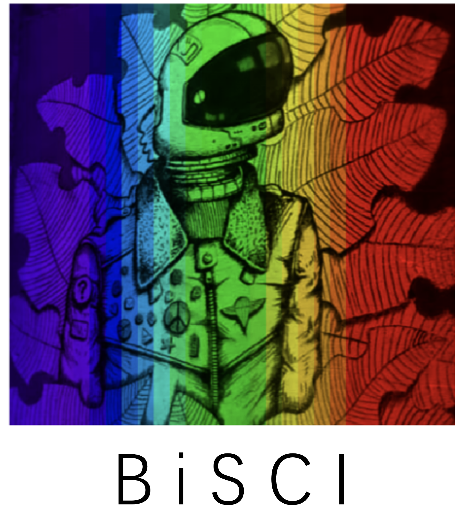
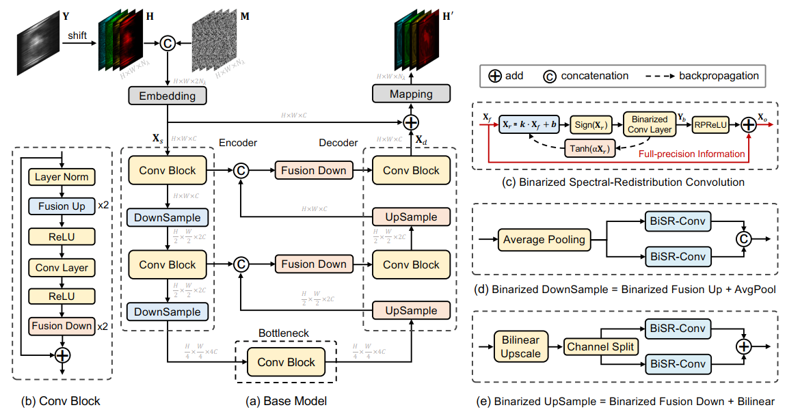
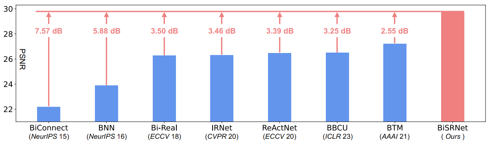
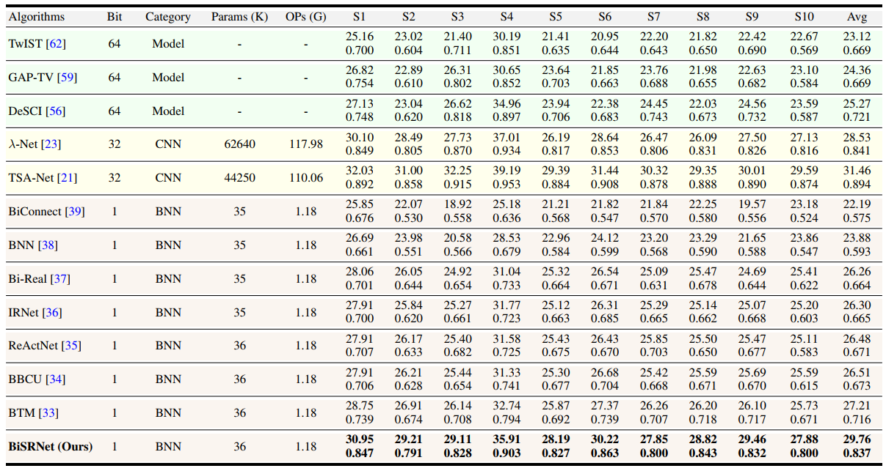
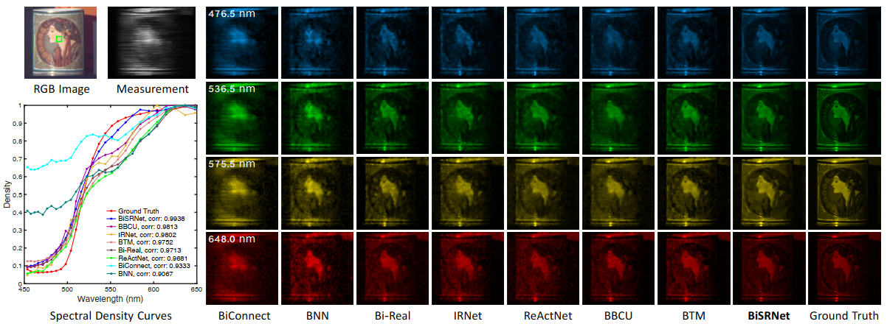
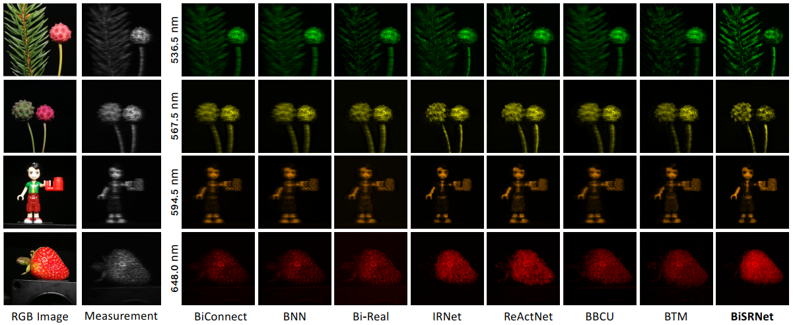

<p align="center"></p>

# A Toolbox for Binarized Spectral Compressive Imaging Reconstruction

<p>
  <a href="https://arxiv.org/abs/2305.10299"></a>
  <a href="https://arxiv.org/abs/2305.10299"></a>
  <a href="https://zhuanlan.zhihu.com/p/668862020"></a>
  <a href="https://huggingface.co/CaiYuanhao/BiSCI"></a>
</p>

#### Authors
Yuanhao Cai, Yuxin Zheng, Jing Lin, Xin Yuan, Yulun Zhang, and Haoqian Wang

#### Paper
[Binarized Spectral Compressive Imaging (NeurIPS 2023)](https://arxiv.org/abs/2305.10299)

#### Introduction
BiSCI is a toolbox with **eight binary neural network methods** for spectral compressive imaging reconstruction, including our **BiSRNet**. It reconstructs hyperspectral images with 28 spectral bands from coded snapshot measurements. We provide training and testing code for simulation and real experiments, pretrained models, and reconstruction results. If you find this repo useful, please give it a star ⭐ and consider citing our paper.

<p align="center"></p>

### News

- **2026.11.10 :** Pretrained weights are now available on [Hugging Face 🤗](https://huggingface.co/CaiYuanhao/BiSCI), with download commands in the Testing sections.

- **2023.11.27 :** Our BiSCI has been added to the [Awesome-Model-Quantization](https://github.com/htqin/awesome-model-quantization) collection. :tada:
- **2023.10.24 :** Code, pre-trained models, and results are released. Feel free to check and use them. ⭐
- **2023.09.22 :** Our paper has been accepted by NeurIPS 2023. Code and models will be released. :rocket:


### Results

- This repo is a toolbox containing eight BNN-based methods for spectral compressive imaging

- Pretrained weights are also available on [Hugging Face](https://huggingface.co/CaiYuanhao/BiSCI) (**8 simulation + 4 real checkpoints**). Original model and result downloads are listed below.


|     Simulation results     |    Simulation models    |    Real results    |    Real models    |
|  :----------------------:  | :---------------------: | :----------------: | :---------------: |
| &ensp;&ensp; [Google](https://drive.google.com/drive/folders/12Dwh-obfWqtsFDWrJPn6qmOpafa2EYHx?usp=sharing) or [Baidu](https://pan.baidu.com/s/1FZRy9fJg1LqvtqJ3PhBL0Q?pwd=cyh2) &ensp;&ensp; | &ensp;&ensp; [Google](https://drive.google.com/drive/folders/11xMKGyQhUW8bvAxtwUCElUgA4kQFGV8g?usp=sharing) or [Baidu](https://pan.baidu.com/s/1kc1uv9xbw757Njymspv8Wg?pwd=cyh2) &ensp;&ensp; | &ensp;&ensp;&ensp; [Google](https://drive.google.com/drive/folders/1w9nvPfxejzm_I7QnAZabuGrDpqb_C78F?usp=sharing) or [Baidu](https://pan.baidu.com/s/1SqKdHhpH9YWVuOS2tQGlIg?pwd=cyh2) &ensp;&ensp;&ensp; | &ensp;&ensp;&ensp; [Google](https://drive.google.com/drive/folders/1v0py8MjMQju5MWTZMkdmPq_elzUco8uh?usp=sharing) or [Baidu](https://pan.baidu.com/s/1ZaffyEDZ0FcdMdhUj7I5Tw?pwd=cyh2) &ensp;&ensp;&ensp; |


<details close>
<summary><b>Quantitative comparisons on the simulation dataset</b></summary>





</details>

<details close>
<summary><b>Qualitative comparisons on the simulation dataset</b></summary>



</details>

<details close>
<summary><b>Qualitative comparisons on the real dataset</b></summary>



</details>

<details close>
<summary><b>Supported Algorithms:</b></summary>

* [x] [BiConnect](https://proceedings.neurips.cc/paper_files/paper/2015/hash/3e15cc11f979ed25912dff5b0669f2cd-Abstract.html) (NeuIPS 2015)
* [x] [BNN](https://proceedings.neurips.cc/paper_files/paper/2016/hash/d8330f857a17c53d217014ee776bfd50-Abstract.html) (NeuIPS 2016)
* [x] [Bi-Real](https://openaccess.thecvf.com/content_ECCV_2018/html/zechun_liu_Bi-Real_Net_Enhancing_ECCV_2018_paper.html) (ECCV 2018)
* [x] [IRNet](https://openaccess.thecvf.com/content_CVPR_2020/html/Qin_Forward_and_Backward_Information_Retention_for_Accurate_Binary_Neural_Networks_CVPR_2020_paper.html) (CVPR 2020)
* [x] [ReActNet](https://link.springer.com/chapter/10.1007/978-3-030-58568-6_9) (ECCV 2020)
* [x] [BBCU](https://arxiv.org/abs/2210.00405) (ICLR 2023)
* [x] [BTM](https://ojs.aaai.org/index.php/AAAI/article/view/16263) (AAAI 2021)
* [x] [BiSRNet](https://arxiv.org/abs/2305.10299) (NeurIPS 2023)


</details>


&nbsp;


## 1. Create Environment:

Use Python 3.10 and an NVIDIA GPU. The following environment was tested with PyTorch 2.5.1 and CUDA 12.1 wheels:

```bash
git clone https://github.com/caiyuanhao1998/BiSCI.git
cd BiSCI
conda create -n bisci python=3.10 -y
conda activate bisci
python -m pip install torch==2.5.1 torchvision==0.20.1 --index-url https://download.pytorch.org/whl/cu121
python -m pip install -r requirements.txt
python -m pip check
```

Run the following sections from the repository root unless a `cd` command is shown. Each training or testing block starts from the repository root. The scripts use GPU 0 by default; add `--gpu_id N` to choose another GPU. See the [validation notes](docs/validation.md) for the executed checks and their scope.

&nbsp;


## 2. Prepare Dataset:

Download cave_1024_28 ([Baidu Disk](https://pan.baidu.com/s/1X_uXxgyO-mslnCTn4ioyNQ), code: `fo0q` | [One Drive](https://bupteducn-my.sharepoint.com/:f:/g/personal/mengziyi_bupt_edu_cn/EmNAsycFKNNNgHfV9Kib4osB7OD4OSu-Gu6Qnyy5PweG0A?e=5NrM6S)), CAVE_512_28 ([Baidu Disk](https://pan.baidu.com/s/1ue26weBAbn61a7hyT9CDkg), code: `ixoe` | [One Drive](https://mailstsinghuaeducn-my.sharepoint.com/:f:/g/personal/lin-j21_mails_tsinghua_edu_cn/EjhS1U_F7I1PjjjtjKNtUF8BJdsqZ6BSMag_grUfzsTABA?e=sOpwm4)), KAIST_CVPR2021 ([Baidu Disk](https://pan.baidu.com/s/1LfPqGe0R_tuQjCXC_fALZA), code: `5mmn` | [One Drive](https://mailstsinghuaeducn-my.sharepoint.com/:f:/g/personal/lin-j21_mails_tsinghua_edu_cn/EkA4B4GU8AdDu0ZkKXdewPwBd64adYGsMPB8PNCuYnpGlA?e=VFb3xP)), TSA_simu_data ([Baidu Disk](https://pan.baidu.com/s/1LI9tMaSprtxT8PiAG1oETA), code: `efu8` | [One Drive](https://1drv.ms/u/s!Au_cHqZBKiu2gYFDwE-7z1fzeWCRDA?e=ofvwrD)), TSA_real_data ([Baidu Disk](https://pan.baidu.com/s/1RoOb1CKsUPFu0r01tRi5Bg), code: `eaqe` | [One Drive](https://1drv.ms/u/s!Au_cHqZBKiu2gYFTpCwLdTi_eSw6ww?e=uiEToT)), and then put them into the corresponding folders of `datasets/` and recollect them as the following form:

```shell
|--BiSCI
    |--real
    	|-- test_code
    	|-- train_code
    |--simulation
    	|-- test_code
    	|-- train_code
    |--visualization
    |--datasets
        |--cave_1024_28
            |--scene1.mat
            |--scene2.mat
            ：  
            |--scene205.mat
        |--CAVE_512_28
            |--scene1.mat
            |--scene2.mat
            ：  
            |--scene30.mat
        |--KAIST_CVPR2021  
            |--1.mat
            |--2.mat
            ： 
            |--30.mat
        |--TSA_simu_data  
            |--mask.mat   
            |--Truth
                |--scene01.mat
                |--scene02.mat
                ： 
                |--scene10.mat
        |--TSA_real_data  
            |--mask.mat   
            |--Measurements
                |--scene1.mat
                |--scene2.mat
                ： 
                |--scene5.mat
```

For the real-data OneDrive link, open the `zyh` folder and place its `mask.mat` and `Measurements/` directly under `datasets/TSA_real_data/`.

Following [MST series work](https://github.com/caiyuanhao1998/MST), we use the CAVE dataset (cave_1024_28) as the simulation training set. Both the CAVE (CAVE_512_28) and KAIST (KAIST_CVPR2021) datasets are used as the real training set.


&nbsp;


## 3. Simulation Experiments

### 3.1&ensp;Training

```shell

cd simulation/train_code/

# Binary Connect
python train.py --outf ./exp/biconnect/ --method biconnect

# BNN
python train.py --outf ./exp/bnn/ --method bnn

# Bi-Real Net
python train.py --outf ./exp/bireal/ --method bireal

# IR-Net
python train.py --outf ./exp/irnet/ --method irnet

# ReActNet
python train.py --outf ./exp/reactnet/ --method reactnet

# BBCU
python train.py --outf ./exp/bbcu/ --method bbcu

# BTM
python train.py --outf ./exp/btm/ --method btm

# BiSRNet
python train.py --outf ./exp/bisrnet/ --method bisrnet

```

- The training logs, trained models, and reconstructed HSIs will be available in `simulation/train_code/exp/`


### 3.2&ensp;Testing

Download the simulation weights from [Hugging Face](https://huggingface.co/CaiYuanhao/BiSCI). Run from the repository root:

```bash
hf download CaiYuanhao/BiSCI --include "Simu_models/*.pth" --local-dir simulation/test_code/model_zoo
```

This saves the eight checkpoints under `simulation/test_code/model_zoo/Simu_models/`. For example, to download only BiSRNet:

```bash
hf download CaiYuanhao/BiSCI Simu_models/bisrnet.pth --local-dir simulation/test_code/model_zoo
```

Prepare `datasets/TSA_simu_data/mask.mat` and the ten scenes in `datasets/TSA_simu_data/Truth/` as described above, then run:

```shell

cd simulation/test_code/

# Binary Connect
python test.py --outf ./exp/biconnect/ --method biconnect --pretrained_model_path ./model_zoo/Simu_models/biconnect.pth

# BNN
python test.py --outf ./exp/bnn/ --method bnn --pretrained_model_path ./model_zoo/Simu_models/bnn.pth

# Bi-Real Net
python test.py --outf ./exp/bireal/ --method bireal --pretrained_model_path ./model_zoo/Simu_models/bireal.pth

# IR-Net
python test.py --outf ./exp/irnet/ --method irnet --pretrained_model_path ./model_zoo/Simu_models/irnet.pth

# ReActNet
python test.py --outf ./exp/reactnet/ --method reactnet --pretrained_model_path ./model_zoo/Simu_models/reactnet.pth

# BBCU
python test.py --outf ./exp/bbcu/ --method bbcu --pretrained_model_path ./model_zoo/Simu_models/bbcu.pth

# BTM
python test.py --outf ./exp/btm/ --method btm --pretrained_model_path ./model_zoo/Simu_models/btm.pth

# BiSRNet
python test.py --outf ./exp/bisrnet/ --method bisrnet --pretrained_model_path ./model_zoo/Simu_models/bisrnet.pth

```

- The reconstructed HSIs will be output into `simulation/test_code/exp/`. Then place the reconstructed results into `simulation/test_code/Quality_Metrics/results` as `Test_result.mat`. From the repository root, run the following command in MATLAB (with Image Processing Toolbox) to calculate PSNR and SSIM.

```shell
cd simulation/test_code/Quality_Metrics/
matlab -batch "Cal_quality_assessment"
```

- #### Evaluating the Params and FLOPS of models

  We have provided a function `my_summary_bnn()` in `simulation/test_code/utils.py`, run the following Python code from that directory to evaluate the parameters and computational complexity of BNNs.

```python
from architecture import BiSRNet
from utils import my_summary_bnn
my_summary_bnn(BiSRNet(stage=1), 256, 256, 28, 1)
```

### 3.3&ensp;Visualization

- Put the reconstructed HSIs in `visualization/simulation_results/results/` and rename it as `method.mat`, e.g., `BiSRNet.mat`

- Generate the RGB images of the reconstructed HSIs:

```bash
cd visualization/
matlab -batch "show_simulation"
```

&nbsp;


## 4. Real Experiments

### 4.1&ensp;Training

```shell

cd real/train_code/

# Binary Connect
python train.py --outf ./exp/biconnect/ --method biconnect

# BNN
python train.py --outf ./exp/bnn/ --method bnn

# Bi-Real Net
python train.py --outf ./exp/bireal/ --method bireal

# IR-Net
python train.py --outf ./exp/irnet/ --method irnet

# ReActNet
python train.py --outf ./exp/reactnet/ --method reactnet

# BBCU
python train.py --outf ./exp/bbcu/ --method bbcu

# BTM
python train.py --outf ./exp/btm/ --method btm

# BiSRNet
python train.py --outf ./exp/bisrnet/ --method bisrnet

```

- The training logs, trained models, and reconstructed HSIs will be available in `real/train_code/exp/`


### 4.2&ensp;Testing

Download the real-data weights from [Hugging Face](https://huggingface.co/CaiYuanhao/BiSCI). Run from the repository root:

```bash
hf download CaiYuanhao/BiSCI --include "Real_models/*.pth" --local-dir real/test_code/model_zoo
```

HF currently provides **BiConnect, BNN, ReActNet, and BiSRNet** for real experiments. Their checkpoints are saved under `real/test_code/model_zoo/Real_models/`. The other four architectures are supported by the training code; use your own trained checkpoints to test them. The original [Google Drive](https://drive.google.com/drive/folders/1v0py8MjMQju5MWTZMkdmPq_elzUco8uh) and [Baidu Disk](https://pan.baidu.com/s/1ZaffyEDZ0FcdMdhUj7I5Tw?pwd=cyh2) links are retained for reference.

Prepare the five measurements in `datasets/TSA_real_data/Measurements/`, then run:

```shell

cd real/test_code/

# Binary Connect
python test.py --method biconnect --pretrained_model_path ./model_zoo/Real_models/biconnect.pth

# BNN
python test.py --method bnn --pretrained_model_path ./model_zoo/Real_models/bnn.pth

# ReActNet
python test.py --method reactnet --pretrained_model_path ./model_zoo/Real_models/reactnet.pth

# BiSRNet
python test.py --method bisrnet --pretrained_model_path ./model_zoo/Real_models/bisrnet.pth

```

- The reconstructed HSIs will be output into `real/test_code/results/`  


### 4.3&ensp;Visualization

- Copy the five reconstructed files from `real/test_code/results/bisrnet/` into `visualization/real_results/results/bisrnet/` (keep the names `1.mat` through `5.mat`).
- Generate the band visualization images with MATLAB (with Image Processing Toolbox):

```bash
cd visualization/
matlab -batch "show_real"
```

&nbsp;


## 5. Citation

```shell
@inproceedings{bisci,
  title={Binarized Spectral Compressive Imaging},
  author={Yuanhao Cai and Yuxin Zheng and Jing Lin and Xin Yuan and Yulun Zhang and Haoqian Wang},
  booktitle={NeurIPS},
  year={2023}
}
```
